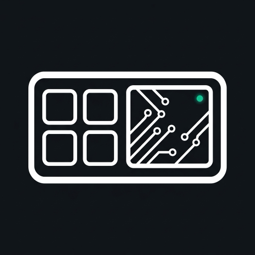
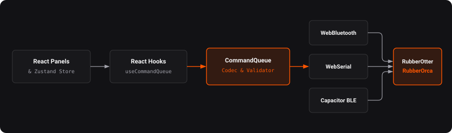

<div align="center">
  
</div>

# RubberDeck

[](https://github.com/AtaCanYmc/RubberDeck/actions/workflows/ci.yml)
[](https://github.com/AtaCanYmc/RubberDeck/actions/workflows/deploy-pages.yml)
[](https://github.com/AtaCanYmc/RubberDeck/releases)
[](https://atacanymc.github.io/RubberDeck/)
[](package.json)
[](tsconfig.json)
[](capacitor.config.ts)
[](LICENSE)

Control PWA and Capacitor 8 mobile application for [RubberOtter](https://github.com/AtaCanYmc/RubberOtter) and [RubberOrca](https://github.com/AtaCanYmc/RubberOrca) USB HID and BLE 5.0 hardware.

Live PWA: https://atacanymc.github.io/RubberDeck/

## Table of Contents

- [Quick Start](#quick-start)
- [Protocol and Profiles](#protocol-and-profiles)
- [Architecture](#architecture)
- [Capacitor 8 Mobile Build](#capacitor-8-mobile-build)
- [Firmware Flashing](#firmware-flashing)
- [FAQ](#faq)
- [Governance and License](#governance-and-license)

## Quick Start

Prerequisites: Node.js 22 or newer and npm 10 or newer.

```bash
git clone https://github.com/AtaCanYmc/RubberDeck.git
cd RubberDeck
npm install
npm run dev
```

Run the full local verification suite:

```bash
npm run lint
npm run typecheck
npm test
npm run build
```

## Protocol and Profiles

RubberDeck implements the RubberOtter v1 wire protocol over BLE 5.0 GATT (`0000ffe0-0000-1000-8000-00805f9b34fb` service and `0000ffe1-0000-1000-8000-00805f9b34fb` characteristic) and USB CDC Web Serial at `115200` baud:

- Framed packet: `[STX: 0x02] [VER: 0x01] [SEQ: 1B] [LEN_HI: 1B] [LEN_LO: 1B] [PAYLOAD: N B] [XOR: 1B] [ETX: 0x03]`
- 6-byte ACK: `[0x02, 0x01, SEQ, OK, CODE, 0x03]` where `CODE` is `1` for invalid version or command, `2` for payload overflow, and `3` for XOR mismatch.
- Single-byte quick commands: `0x11` through `0x85` and relative mouse packet `0x80 <dx> <dy>`.
- Command chaining: `&&` and `;`.

| Profile | Target Hardware | Max Payload | Capabilities |
| :--- | :--- | :--- | :--- |
| `rubberotter` | ATmega32U4 + HM-10 / ESP32 | `384 B` | Keyboard, mouse, media, jiggler, haptics, quick macros |
| `rubberorca` | ESP32-S3 | `1024 B` | All RubberOtter features plus 16 NVS macros (`m0..m15`), `layout us\|tr_q`, `ble name`, `ble passkey <100000..999999\|off>` |

## Architecture



Repository layout:

```text
RubberDeck/
├── .github/                  # CI, GitHub Pages, Release Please, Dependabot, templates
├── docs/                     # Architecture, wire protocol, and transport specifications
├── public/
│   └── favicon.svg           # PWA icon asset
├── src/
│   ├── components/
│   │   ├── layout/           # Header.tsx, NavBar.tsx
│   │   ├── panels/           # DeviceConfig, FirmwareLinks, Macro, Media, Presentation, Security, TextConsole, Trackpad
│   │   └── ui/               # HardwareCard, SectionLabel, StatusLed, TactileButton
│   ├── hooks/                # useDeviceConnection.ts, useCommandQueue.ts
│   ├── protocol/             # Pure TypeScript codec, byteMap, constants, profiles, commandValidator, commandQueue
│   ├── services/             # haptics.ts
│   ├── store/                # useDeckStore.ts (Zustand state)
│   ├── transport/            # webBluetooth.ts, webSerial.ts, capacitorBle.ts, mockTransport.ts, types.ts
│   ├── App.tsx               # Root application shell
│   ├── index.css             # Tailwind CSS v4 entry
│   └── main.tsx              # React 19 entry point
├── tests/                    # Vitest unit tests for codec, validator, and command queue
├── capacitor.config.ts       # Capacitor 8 Android and iOS configuration
├── eslint.config.js          # ESLint 9 flat configuration
├── index.html                # Vite HTML entry
├── package.json              # Scripts and dependencies
├── tsconfig.json             # TypeScript compiler configuration
└── vite.config.ts            # Vite 6 + vite-plugin-pwa configuration
```

`src/protocol/` has zero browser, DOM, or Capacitor dependencies so protocol framing, validation, and ACK queueing remain deterministic and testable in Node.

## Capacitor 8 Mobile Build

```bash
npx cap add android
npx cap add ios
npm run cap:sync
npm run cap:open:android
npm run cap:open:ios
```

## Firmware Flashing

RubberDeck excludes firmware binaries, flash manifests, and Web Serial flasher code by design. Flash target devices using their dedicated hardware repositories:

- RubberOtter Flasher: https://atacanymc.github.io/RubberOtter/
- RubberOrca Flasher: https://atacanymc.github.io/RubberOrca/ and repository https://github.com/AtaCanYmc/RubberOrca

## FAQ

### Why does RubberDeck not include firmware flashing?

Separating runtime HID control from firmware flashing keeps the PWA bundle small, avoids bundling board-specific `.hex` or `.bin` artifacts, and prevents accidental writes to device flash from a mobile control surface.

### Which browsers support Web Bluetooth and Web Serial?

Desktop Chromium browsers support both Web Bluetooth and Web Serial over HTTPS or `localhost`. iOS Safari does not expose Web Bluetooth, so use the Capacitor 8 iOS build via `CapacitorBleTransport`.

### Does RubberDeck work offline?

Yes. `vite-plugin-pwa` precaches the static application bundle via Workbox, and all BLE or USB CDC communication runs directly between the client device and local hardware without a backend server.

## Governance and License

- Technical documentation index: [docs/README.md](docs/README.md) ([architecture](docs/architecture.md), [protocol](docs/protocol.md), [transports](docs/transports.md), [app-store-review](docs/app-store-review.md))
- Contribution workflow and commit conventions: [CONTRIBUTING.md](CONTRIBUTING.md)
- Vulnerability reporting and response SLA: [SECURITY.md](SECURITY.md)
- Planned milestones: [ROADMAP.md](ROADMAP.md)
- License: [MIT](LICENSE)
